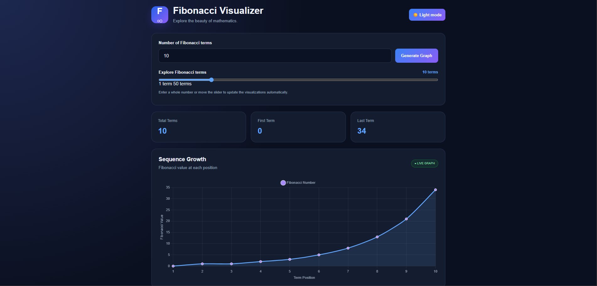
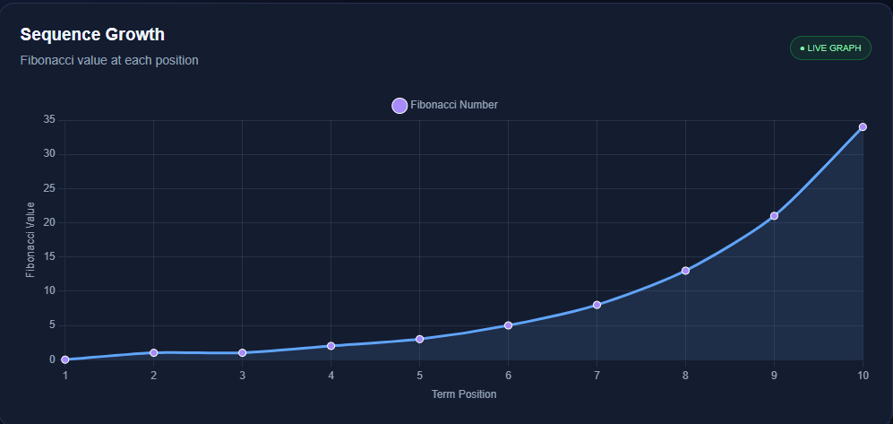
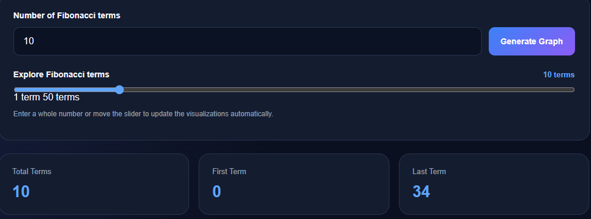

# 🌀 Fibonacci Visualizer

An interactive Fibonacci sequence visualizer built with **HTML, CSS,
JavaScript, Node.js, and Express**. Explore Fibonacci numbers, adjust
the number of terms with a slider, and see the sequence update across
the visualizations.

🔗 **GitHub Repository:**
https://github.com/jeetxgeek/Fibonacci-Visualizer

------------------------------------------------------------------------

## ✨ Features

-   **Interactive term slider** --- choose between 1 and 50 Fibonacci
    terms.
-   **Dynamic Fibonacci sequence** --- update the sequence without
    manually refreshing the page.
-   **Visual representation** --- explore the generated values through a
    chart and other visual elements.
-   **Statistics** --- view useful information about the generated
    sequence, such as its first and last terms.
-   **Light and dark themes** --- switch the appearance to suit your
    preference.
-   **Express REST API** --- generate Fibonacci values through a backend
    endpoint.
-   **Organized backend structure** --- routes, controllers, and
    services are separated for easier maintenance.

## 🖼️ Screenshots

> Add your own screenshots to `docs/images/` using the filenames below.
> The images will appear here once you add them to the repository.

### Main Dashboard



### Interactive Chart and Sequence



### Slider and Theme



------------------------------------------------------------------------

## 🧰 Tech Stack

  Technology   Purpose
  ------------ ------------------------------------
  HTML5        Page structure
  CSS3         Styling, layout, and themes
  JavaScript   Interactive frontend behavior
  Chart.js     Data visualization
  Node.js      JavaScript runtime for the backend
  Express.js   Web server and REST API

## 📁 Project Structure

``` text
Fibonacci-Visualizer/
├── public/
│   ├── index.html
│   ├── script.js
│   └── style.css
├── src/
│   ├── controllers/
│   │   └── fibonacci.controller.js
│   ├── routes/
│   │   └── fibonacci.routes.js
│   └── services/
│       └── fibonacci.service.js
├── .gitignore
├── package.json
├── package-lock.json
└── server.js
```

## 🚀 Getting Started

### Prerequisites

Install **Node.js and npm** on your computer. You can check whether they
are installed by running:

``` bash
node --version
npm --version
```

### 1. Clone the repository

``` bash
git clone https://github.com/jeetxgeek/Fibonacci-Visualizer.git
cd Fibonacci-Visualizer
```

### 2. Install dependencies

``` bash
npm install
```

### 3. Start the server

``` bash
npm start
```

### 4. Open the application

Visit **http://localhost:3000** in your browser.

## 🔌 API Reference

### Get Fibonacci terms

``` http
GET /api/fibonacci?n=10
```

The `n` query parameter controls how many terms to generate. The
visualizer supports values from **1 to 50**.

Example request:

``` text
http://localhost:3000/api/fibonacci?n=10
```

Example response:

``` json
{
  "count": 10,
  "sequence": [0, 1, 1, 2, 3, 5, 8, 13, 21, 34],
  "firstTerm": 0,
  "lastTerm": 34
}
```

## 🧠 What I Learned

-   Building a frontend that communicates with a backend API.
-   Creating REST endpoints with Express.js.
-   Separating backend logic into routes, controllers, and services.
-   Updating charts and interface elements from API data.
-   Managing project changes with Git and GitHub.

## 🛠️ Future Improvements

-   Add automated tests for the API and Fibonacci service.
-   Improve accessibility and keyboard navigation.
-   Add more visualization styles and export options.
-   Deploy the application so it can be used without running it locally.

## 👨‍💻 Author

**Jeetxgeek**

-   GitHub: [@jeetxgeek](https://github.com/jeetxgeek)

------------------------------------------------------------------------

If you find this project useful or have suggestions, feel free to open
an issue or contribute!
